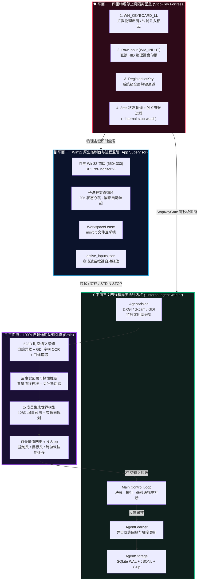

<div align="center">

```text
╔══════════════════════════════════════════════════════════════════════════════════════════╗
║                                                                                          ║
║   ██╗    ██╗██╗███╗   ██╗ ██████╗  █████╗ ███╗   ███╗███████╗     █████╗  ██████╗ ███████╗███╗   ██╗████████╗   ║
║   ██║    ██║██║████╗  ██║██╔════╝ ██╔══██╗████╗ ████║██╔════╝    ██╔══██╗██╔════╝ ██╔════╝████╗  ██║╚══██╔══╝   ║
║   ██║ █╗ ██║██║██╔██╗ ██║██║  ███╗███████║██╔████╔██║█████╗      ███████║██║  ███╗█████╗  ██╔██╗ ██║   ██║      ║
║   ██║███╗██║██║██║╚██╗██║██║   ██║██╔══██║██║╚██╔╝██║██╔══╝      ██╔══██║██║   ██║██╔══╝  ██║╚██╗██║   ██║      ║
║   ╚███╔███╔╝██║██║ ╚████║╚██████╔╝██║  ██║██║ ╚═╝ ██║███████╗    ██║  ██║╚██████╔╝███████╗██║ ╚████║   ██║      ║
║    ╚══╝╚══╝ ╚═╝╚═╝  ╚═══╝ ╚═════╝ ╚═╝  ╚═╝╚═╝     ╚═╝╚══════╝    ╚═╝  ╚═╝ ╚═════╝ ╚══════╝╚═╝  ╚═══╝   ╚═╝      ║
║                                                                                          ║
║        SINGLE-FILE · ZERO EXTERNAL AI MODELS · AIRPLANE-MODE READY · WIN11 x64           ║
╚══════════════════════════════════════════════════════════════════════════════════════════╝
```

<h3>🚀 仅凭单一 <code>WindowsGameAgent.py</code>，在 Windows 11 x64 上实现完全离线、全栈自主、不可阻断的通用游戏 Agent</h3>

<p>
  
  
  
  
  
  
</p>

<p>
  <a href="#-核心铁律与工程哲学">核心铁律</a> •
  <a href="#-端到端运行生命周期">运行流程</a> •
  <a href="#-四平面系统架构">系统架构</a> •
  <a href="#-100-原生自建认知引擎">自建 AI 引擎</a> •
  <a href="#-硬件级停止键隔离堡垒">停止键隔离</a> •
  <a href="#-快速开始">快速开始</a> •
  <a href="#-目录隔离与-1mb-黑匣子">黑匣子与数据</a>
</p>

</div>

---

> [!IMPORTANT]
> **零外部模型 · 零注释冗余 · 零环境污染**  
> 本项目仅包含 **`WindowsGameAgent.py`** 一个核心文件（不依赖 PyTorch / TensorFlow / OpenCV / PyQt 等重型框架，且源码严格遵循「零注释、零文档字符串、100% 参与运行」）。所有 **Win32 原生界面、DXGI COM 桌面复制采集、GDI 汉字/数字字模 OCR、多目标追踪、因果控制推断、集成世界模型、双头强化学习、10 点原生触控注入与四通道硬件级停止键监听** 全部原生内建于单文件之中。

---

## ⚡ 核心铁律与工程哲学

本项目的每一行代码都严格受 [`AGENTS202611192033.md`](./AGENTS202611192033.md) 约束，构建出一套近乎严苛的工程边界：

| 铁律 | 架构级硬核实现 |
| :--- | :--- |
| 🧱 **单文件极简交付** | 仅需 **`WindowsGameAgent.py`** + Python 3.15，启动时即关闭字节码缓存（`sys.dont_write_bytecode = True`）并自动释放控制台，纯原生 Win32 GUI 驱动。 |
| 🧠 **严禁他人 AI 模型** | 视觉特征（528 维）、自编码隐空间（64→16→64）、系统字体 OCR、目标追踪、因果统计、双成员集成世界模型、双头 Q 网络全部自研自建，**0 外部模型权重**。 |
| ✈️ **真·飞行模式离线可用** | 首次准备完成 SHA-256 校验安装后，立即执行**断网子进程冷启动预检**（阻断 `socket` / `urllib` 验证全链路），随后全程断网亦可完整推理、在线训练与存取盘。 |
| 🔥 **不可阻断的自主执行** | 点击 **「启动」** 后自动隐藏主界面并拉起独立监控子进程。无论游戏画面黑屏、卡顿、窗口失焦还是异常崩溃，只要未按停止键，监管进程自动重启恢复，**绝不暂停或停止**。 |
| 🛡️ **停止键绝对隔离防线** | Agent 可控制键盘、鼠标、滚轮与多点触控的一切组合，**唯独不能生成、组合或注入停止键**；由底层钩子、Raw Input、全局热键与独立守护进程四重物理监听。 |
| 🔒 **严格版本数据隔离** | 启动即计算脚本自身 `SHA-256` 前 20 位生成 `SOURCE_BUILD`，配合 `MODEL_FORMAT=21` 与 SQLite `user_version` 校验，**严禁读取或迁移任何旧版本数据**。 |

---

## 🔄 端到端运行生命周期

从双击运行到一键打包黑匣子，全链路严格遵循以下确定性状态机：

```mermaid
flowchart LR
    A(["🚀 开始运行"]) --> B["📁 选择文件夹<br/>WorkspaceLease 目录租约锁"]
    B --> C["📦 智能下载与校验<br/>PyPI SHA-256 · NumPy/CuPy 测速选型"]
    C --> D["🧪 断网冷启动全链路预检<br/>采集 · 训练 · SQLite WAL · 1MB 黑匣子"]
    D --> E(["🟢 一切就绪"])
    E --> F["🖱️ 用户点击「启动」"]
    F --> G["🫥 隐藏主界面<br/>拉起独立 Agent 子进程"]
    G --> H[["⚡ Agent 持续自主操作与在线学习<br/>(异常自动恢复 / 90s 心跳重启 / 永不自停)"]]
    H -- "⌨️ 用户按下物理停止键" --> I["🛑 四通道实时截断<br/>释放全部按键/鼠标/触控 · 落盘检查点"]
    I --> J["🪟 恢复显示主界面"]
    J --> K["🧰 点击「黑匣子」<br/>桌面生成 ≤1MB 诊断压缩包"]
    J -.->|"修改范围/停止键重新就绪或再次启动"| F

    style A fill:#0f172a,stroke:#38bdf8,color:#ffffff,stroke-width:2px
    style B fill:#1e293b,stroke:#60a5fa,color:#ffffff,stroke-width:2px
    style C fill:#1e293b,stroke:#a78bfa,color:#ffffff,stroke-width:2px
    style D fill:#1e293b,stroke:#f59e0b,color:#ffffff,stroke-width:2px
    style E fill:#064e3b,stroke:#10b981,color:#ffffff,stroke-width:2px
    style F fill:#0f172a,stroke:#34d399,color:#ffffff,stroke-width:2px
    style G fill:#1e293b,stroke:#818cf8,color:#ffffff,stroke-width:2px
    style H fill:#3b0764,stroke:#e879f9,color:#ffffff,stroke-width:2px
    style I fill:#7f1d1d,stroke:#f87171,color:#ffffff,stroke-width:2px
    style J fill:#0f172a,stroke:#38bdf8,color:#ffffff,stroke-width:2px
    style K fill:#451a03,stroke:#fbbf24,color:#ffffff,stroke-width:2px
```



---

## 🏗️ 四平面系统架构

为了确保 **「Agent 永不卡死」** 与 **「停止键绝对优先」**，系统在进程级与线程级切分为四个物理隔离的运行平面：



---

## 🎛️ 原生 Win32 界面与交互规范

> [!NOTE]
> 严格遵守 **`严禁存在未提及的交互功能`**，界面仅保留最纯粹、最直接的 5 个核心交互控件：

<div align="center">

```text
┌──────────────────────────────────────────────────────────────────────────────┐
│  通用游戏 Agent                                                      [─][□][×]│
├──────────────────────────────────────────────────────────────────────────────┤
│                                                                              │
│  游戏 Agent · 本地自主探索与在线学习                                          │
│                                                                              │
│  ┌──────────────────┐                                                        │
│  │    选择文件夹     │   X:\YourFolder\WindowsGameAgent-data-a1b2c3d4e5...    │
│  └──────────────────┘                                                        │
│                                                                              │
│  Agent 操作范围：  ┌──────────────────▼┐     停止键：  ┌──────────────────▼┐ │
│                    │ 全屏              │               │ ESC              │ │
│                    └──────────────────┘               └──────────────────┘ │
│                                                                              │
│  ┌──────────────────────┐   ┌──────────────────────┐                         │
│  │         启动         │   │        黑匣子        │                         │
│  └──────────────────────┘   └──────────────────────┘                         │
│                                                                              │
│  状态：一切就绪 · 本地离线运行 · 基准决策约 XX.X 毫秒...                       │
│                                                                              │
└──────────────────────────────────────────────────────────────────────────────┘
```

</div>

| 控件 / 设置项 | 默认值 | 可选范围与行为说明 |
| :--- | :---: | :--- |
| **选择文件夹** | 启动自动弹出 | 选定本地磁盘目录后自动加锁创建 `WindowsGameAgent-data-<SOURCE_BUILD>` 子目录，所有模型、经验、日志与运行组件均收拢于此。 |
| **Agent 操作范围** | **`全屏`** | • **`全屏`**：覆盖完整虚拟桌面坐标系（支持多显示器拼接）。<br/>• **`窗口`**：智能识别并锁定前台游戏窗口（依据进程名、窗口类、动态纹理与画面活动度），失焦自动唤起，绝不误切至系统桌面或无关窗口。 |
| **停止键** | **`ESC`** | 支持全键盘常见功能键与字母数字键（`ESC`、`F1–F24`、`A–Z`、`0–9`、`Space`、`Tab`、`Enter`、左右 `Shift/Ctrl/Alt`、媒体键、小键盘等）。 |
| **启动** | 预检后解锁 | 立即隐藏主界面并启动 Agent，仅在按下所设定的停止键后退出操作并重新显示主界面。 |
| **黑匣子** | 文件夹就绪后可用 | 在 Windows **桌面** 生成一个严格 **`≤ 1 MB`（≤ 1,000,000 字节）** 的 `.zip` 诊断归档包。 |

---

## 🧠 100% 原生自建认知引擎

拒绝一切外部神经网络与第三方 API。`Brain` 从原始像素与 OS 级反馈中自底向上构建完整的游戏理解：

### 1. `528` 维高密度时空语义表征

```text
|<--------------------------------------- FEATURE_COUNT = 528 --------------------------------------->|
[ 0..17 ]  全局基础统计 (18D): 亮度 / 方差 / RGB均值 / 瞬时变化 / 边缘 / 饱和度 / 新颖度 / 停滞度 / 运动与显著重心
[ 18..149] 多尺度局部网格 (132D): 3×4 区块 7通道统计 + 4×8 亮度网格 + 960×540 动态焦距特征 + 显著峰值坐标
[150..447] 细粒度时空热图 (298D): 4×8 运动边缘色彩 + 8×8 局部对比度 / 多帧运动能量 / 红蓝对比 / 追踪目标热力图
[448..511] 视觉语义向量   (64D): 自研 OCR 文本与数字 / 阶段信号 / HUD 彩条读数 / 可控目标速度 / 相对关闭速率 / 近期动作
[512..527] 隐空间自编码器 (16D): 在线自监督 VisualRepresentation (64→16→64) 隐向量 + 动作条件转移增量学习
```

### 2. 六大自建智能核心

<details>
<summary><b>🔬 点击展开：查看六大核心模块的算法原理与代码级实现</b></summary>

1. **零外部依赖多源视觉感知**
   - **双分辨率动态注视（Foveal Attention）**：常规 `320×180`（`20×12` 区块）全景扫描 + 自适应 `960×540` 局部高分辨率裁剪，自动聚焦于低置信度 UI 文本、未知图标或高频交互目标。
   - **纯 Windows 原生 OCR + 在线字形聚类**：内建 `0–9`/`A–Z` 像素字模（`GLYPH_ROWS`），并实时利用 GDI 渲染系统字体（微软雅黑 / 宋体 / 正黑体）构建汉字高频词模板库（`LocalGlyphTemplates`），同时在运行中自我归纳高频新字形（`adaptive_glyphs`）与未知形状（`unknown_glyphs`）。
   - **多目标追踪与相机自运动分离**：结合颜色、邻域外观、连通域几何形态（`visual_region`）与速度外推进行跨帧追踪与遮挡恢复；通过全局像素平移对齐（`aligned_visual_change`）与速度一致性剥离背景卷轴/视角晃动。

2. **反事实因果可控性推断**
   - 建立分场景、分时长段（short/medium/long）的**被动背景运动分布基线**（`passive_timed`、`passive_motion_profiles` 12 分区均值方差）。
   - 动作执行前后采集多帧序列，过滤无输入或背景自然漂移干扰，利用成对对照探测（`paired_probe_evidence`）与贝叶斯 Beta 后验（`control_posteriors`）精确判定「某动作是否真正控制了画面」。

3. **双成员集成世界模型 & 束搜索规划**
   - `2` 组异构初始化的神经网络集成（`w1/w2` 与 `w1_alt/w2_alt`），结合场景条件表与被动转移模型，预测未来 `128` 维世界状态增量与收益。
   - 通过独立场景组留出验证（`world_holdout_groups`）与双模型分歧度动态校准不确定性，自适应调节束搜索规划深度（Horizon 2–5 步），并在执行偏离预测时毫秒级重规划。

4. **双头价值学习与长期因果归因**
   - **多头解耦结构**：共享 `528→128` 编码器，分离 **控制头（`control_head`）**、**目标头（`objective_head`）**、**Double Q 网络** 与 **长期任务 Q 网络（`task_q`）**，辅以自监督解码重建与时序不变性对比损失。
   - **时间感知折扣与 128 步长期归因**：使用真实动作耗时计算时间衰减（`temporal_discount`、`long_goal_discount`），结合 `N_STEP=6` 轨迹聚合与长达 `128` 步的因果加权终局回溯（`credit_long_outcome`）。

5. **三阶段自主探索与联合参数优化**
   - 自动演进探索阶段：**`discovery`（广度探测）→ `causal`（因果收敛）→ `policy`（策略利用）**。
   - 结合**每秒信息增益（Information Gain / √s）**、Thompson 采样、上下文联合参数评估（`choose_joint`）与连续参数预测头（`parameter_heads`），同时优化「选什么动作 + 点哪里 + 按多久 + 拖多远」。

6. **跨游戏技能迁移与意图重映射**
   - 提取带前置条件、空间锚点、相对物体关系（平移不变 `skill_relation_summary`）的高质量动作序列技能。
   - 迁移至新游戏时，若原有按键失效，依据逆动力学（`inverse_dynamics`）与局部控制后验自动执行**语义意图重映射**（`remap_skill_intent`，例如自动将无效的 `W` 切换为 `↑`）。

</details>

---

## 👁️ 三级图像采集与全栈 OS 控制

### 🎥 三级自适应图像采集引擎
| 优先级 | 采集后端 | 技术实现细节 |
| :---: | :--- | :--- |
| **Tier 1** | **`NativeDXGI`** | 通过 `ctypes` 直调 `d3d11.dll` 创建硬件设备并操作 `IDXGIOutputDuplication` COM 虚函数表，支持**跨多显示器拼接捕获**（`_grab_spanned`）与受保护内容检测。 |
| **Tier 2** | **`dxcam`** | 若环境已存在 `dxcam` 与 `numpy` 且原生 DXGI 不可用时自动无缝接管。 |
| **Tier 3** | **`GDI StretchBlt`** | `SRCCOPY \| CAPTUREBLT` 纯系统内核级保底捕获，即使在精简环境或无 GPU 环境下依然 100% 可用。 |

### 🎮 `27` 种通用输入原语（4 大动作家族）
| 动作家族 | 包含原语 (`Action.kind`) | 物理注入通道 |
| :--- | :--- | :--- |
| **Keyboard** | `key`（VK 8–254）、`hold`（持续按住）、`chord`（修饰键组合）、`pair_hold`（双键协同移动/跳跃）、`compose`（动态组合按键+鼠标） | `SendInput` 硬件扫描码 (`KEYEVENTF_SCANCODE`) + 扩展键标志 |
| **Pointer** | `click`、`right`、`double`、`middle`、`focus_click`、`focus_right`、`focus_double`、`press`、`touch_tap`、`xbutton` | `SendInput` 绝对虚拟桌面坐标 + 动态注意力锚点精调 |
| **Navigation** | `move`、`swipe`、`right_swipe`、`look`、`wheel`、`hwheel`、`touch_swipe`、`pinch`（双指缩放）、`dual_touch`（双指虚拟摇杆+按键） | 平滑缓动轨迹（Smoothstep Glide）+ 原生 Windows 10 点触控注入 (`InjectTouchInput`) |
| **Combat** | `combat`、`aim`、`move_fire` | 移动 + 射击/准星扫描并发控制 + 动作期间高频视觉变更实时打断 |

---

## 🛡️ 硬件级停止键隔离堡垒

> [!CAUTION]
> **铁律：`Agent 可以控制一切，但唯独不能控制停止键`**  
> 系统在 **动作生成 → 动作合成 → 驱动注入 → 物理监听** 四个环节构建了不可绕过的硬件隔离墙：

1. **生成阶段绝对剔除**：`actions_for(stop_vk)` 在构建动作表时即过滤停止键及其等效左右修饰键（`stop_equivalent`，如选择 `Shift` 则同时屏蔽 `LShift` / `RShift`）。
2. **发送内核物理硬锁**：`Controller.send()` 与 `Controller.key()` 对任何扫描码与虚拟键执行二次反查，**物理级拒绝**发送任何等同于 `stop_vk` 的按键报文。
3. **四通道物理监听矩阵**：
   - **通道 A**：`WH_KEYBOARD_LL` 全局底层键盘钩子（严格核验 `LLKHF_INJECTED` 标志，仅放行物理击键并吞掉停止事件）。
   - **通道 B**：`WM_INPUT` HID 原始键盘输入（校验真实硬件设备句柄 `hDevice`）。
   - **通道 C**：`RegisterHotKey`（`MOD_NOREPEAT`）系统全局热键兜底。
   - **通道 D**：主进程 `8ms` `GetAsyncKeyState` 高频轮询线程 **+ 独立守护子进程 `--internal-stop-watch`**（通过匿名管道直报 `STOP`）。
4. **遗留输入强制清零**：收到停止信号或子进程意外退出时，监管层读取落盘账本 `active_inputs.json`，对所有按住的键盘键、鼠标键及触控点执行带重试确认的彻底释放（`repair_release`）。

---

## 📦 智能下载、断网预检与加速后端

在「智能下载」阶段，程序会根据当前设备软硬件环境自动完成合规组件部署与冷启动测速：

- **精确版本与安全校验**：按当前 Python ABI 匹配兼容的 `numpy`（`>=2.5.0, <3`）与 `cupy-cuda12x`（`>=14.2.0, <15`，仅当系统存在 `nvcuda.dll` 时探测），直接向 PyPI JSON 接口核对每个 `.whl` 文件的 **`SHA-256` 发布摘要**。
- **实测择优而非盲目上 GPU**：对 `cupy` 与 `numpy` 执行实际的决策/矩阵梯度吞吐基准测试，仅当 `GPU 耗时 < CPU 耗时 × 0.90` 时才启用 GPU 加速；无网络或无编译轮子时，自动切换至 **纯 Python 离线后端**。
- **断网冷启动预检（`verify_offline_cold_start`）**：每次「一切就绪」前，自动拉起一个**禁用全部网络 API**（接管并阻断 `socket` / `getaddrinfo` / `urlopen`）的隔离测试子进程，连续通过屏幕采集、输入与停止键门控、SQLite WAL 事务回读、20 套合成闭环与智能退化回归测试、Gzip 检查点还原及黑匣子打包验证后，方解锁「启动」按钮。

---

## 🧰 目录隔离与 ≤1MB 黑匣子

### 📁 严格隔离的数据目录结构
除桌面黑匣子外，所有文件全部存放于用户选定文件夹下的版本专属目录 `WindowsGameAgent-data-<SOURCE_BUILD>/` 内：

```text
<用户选择的文件夹>/
├── .agent_workspace_<SOURCE_BUILD>.lock       # msvcrt 多开互斥租约锁
└── WindowsGameAgent-data-<SOURCE_BUILD>/
    ├── _runtime/                              # 经 SHA-256 校验安装的本地 CPU 数值库
    ├── _gpu_runtime/                          # 经实测通过的本地 GPU 加速库 (如适用)
    ├── _verified_wheels/                      # 离线 Wheel 缓存与校验清单 (*.json)
    ├── experience.sqlite3 (+ -wal / -shm)     # SQLite WAL 经验与关键帧数据库
    ├── experience_overflow.jsonl              # 断库期间崩溃安全经验溢写日志
    ├── learning_state.json.gz (.bak)          # SHA-256 完整性校验完整模型检查点 + 备份
    ├── learning_delta.json.gz                 # 增量模型检查点
    ├── runtime_state.json                     # 实时运行态与首跑诊断遥测
    ├── runtime_profile.json                   # 离线基准推理耗时测试报告
    ├── supervisor_state.json                  # 子进程监管与恢复状态
    ├── active_inputs.json                     # 当前按下按键/鼠标/触控防卡死账本
    └── agent_errors.jsonl                     # 异常自愈记录日志
```

### 🗜️ 桌面黑匣子（严格 `≤ 1,000,000` 字节）
点击 **「黑匣子」** 按钮后，在系统桌面自动生成 `游戏Agent黑匣子_YYYYMMDD_HHMMSS_<UID>.zip`，内含自适应裁剪的高价值排障信息：
- `report.json`：完整运行概览、因果发现率、留出世界模型验证误差、双头覆盖率、硬件输入统计与停止键通道状态。
- `learning_diagnostics.json`、`runtime_state.json`、`runtime_profile.json`、`supervisor_state.json`：全方位学习与系统画像。
- `recent_actions.json`、`recent_errors.json`、`error_log_tail.jsonl`：近期动作决策链路与异常尾部日志。
- `last_screen.png`：无损编码的最新 `320×180` 观测现场画面。
- **自适应权重打包**：容量允许时打包完整的 `learning_state.json.gz` + `learning_delta.json.gz`；若模型体积超出 1MB 预算，自动降级提取活动游戏的 **IEEE-754 FP16（binary16）核心权重摘录**（`active_model_fp16.bin` + `active_model_layout.json`）或多级精简报告，确保压缩包**永远严格 ≤ 1MB**。

---

## 🚀 快速开始

### 运行环境要求
- **操作系统**：Windows 11 x64
- **Python 版本**：Python 3.15
- **网络条件**：仅首次「智能下载」需要联网拉取并校验数值加速 Wheel（也可完全跳过直接在纯 Python 环境下离线运行）；「一切就绪」后**可开启飞行模式永久断网使用**。

### 启动步骤
```powershell
# 克隆仓库或仅下载 WindowsGameAgent.py 单文件
python WindowsGameAgent.py
```

1. **选择文件夹**：运行后自动弹出系统目录选择框，选定任意本地磁盘文件夹用于存储运行组件与经验。
2. **等待智能准备**：程序自动完成加速库下载校验、采集/输入链路检测、SQLite WAL 事务验证与断网闭环预检，状态栏提示 **`一切就绪`**。
3. **调整设置（可选）**：设置操作范围为 **`全屏`**（默认）或 **`窗口`**，并设定 **`停止键`**（默认 `ESC`；更改设置会自动重验就绪状态）。
4. **点击「启动」**：主界面自动隐藏，切换到任意游戏界面，Agent 立即开始自主探索与在线学习；此时即便断网或开启飞行模式亦可完整使用。
5. **停止与黑匣子**：随时按下设定的 **停止键**，Agent 瞬间安全释放所有输入并重新显示主界面；点击 **「黑匣子」** 即可在桌面生成 `≤ 1MB` 诊断压缩包。

> [!WARNING]
> **管理员权限游戏提示**：若目标游戏以管理员权限（Elevated / UAC）运行，Windows UIPI 安全机制会阻止普通权限进程向其发送 `SendInput` 与注入全局钩子；如需操作此类游戏，请以管理员权限启动 `WindowsGameAgent.py`。

---

<div align="center">
  <sub>Built with pure Windows 11 native primitives & 100% self-crafted learning intelligence · Strictly conforming to <code>AGENTS202611192033.md</code></sub>
</div>
